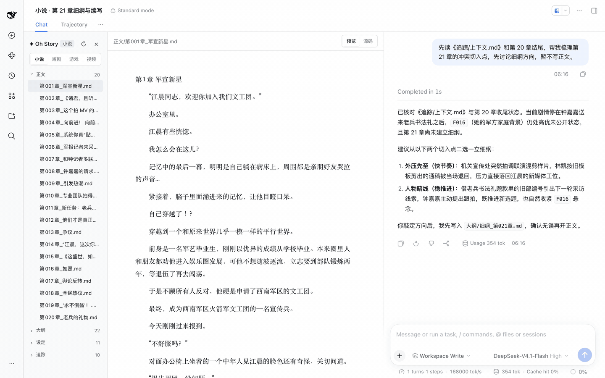
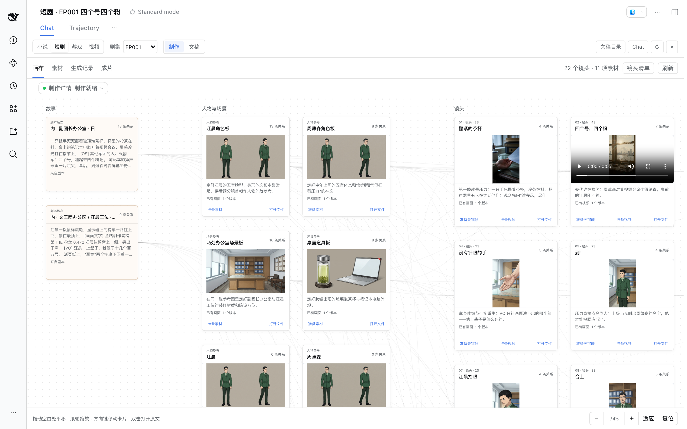
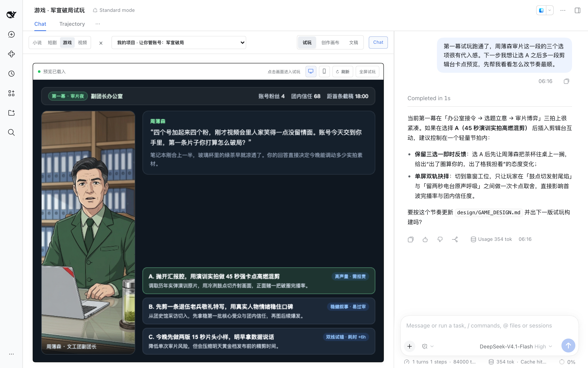
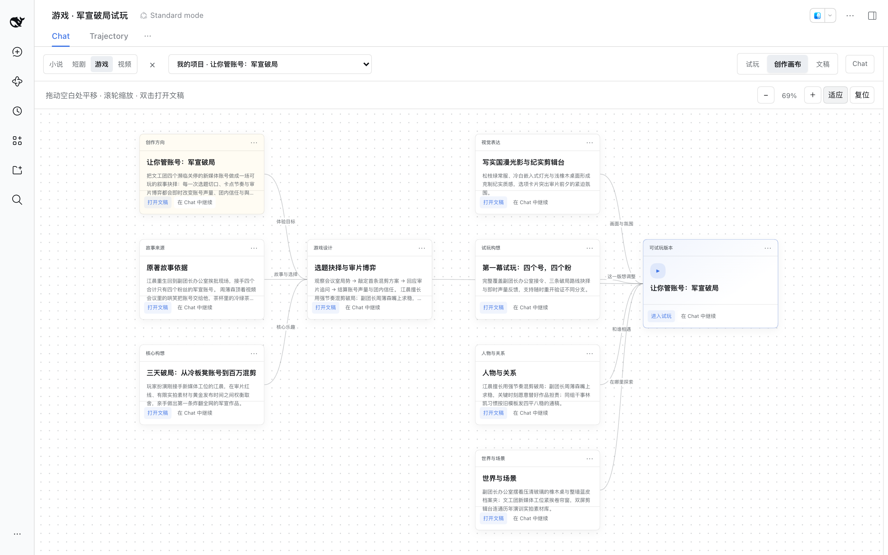
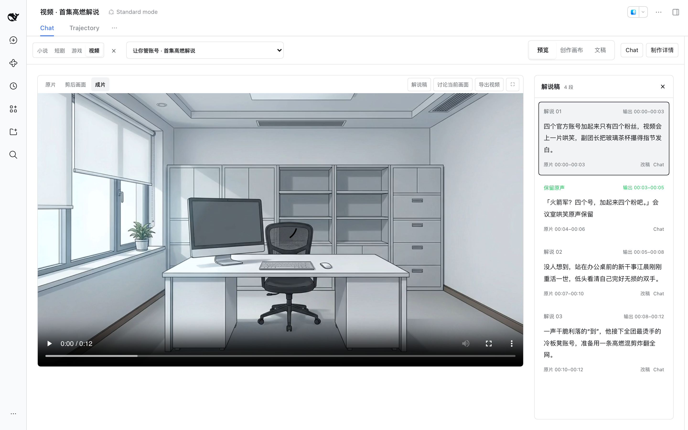
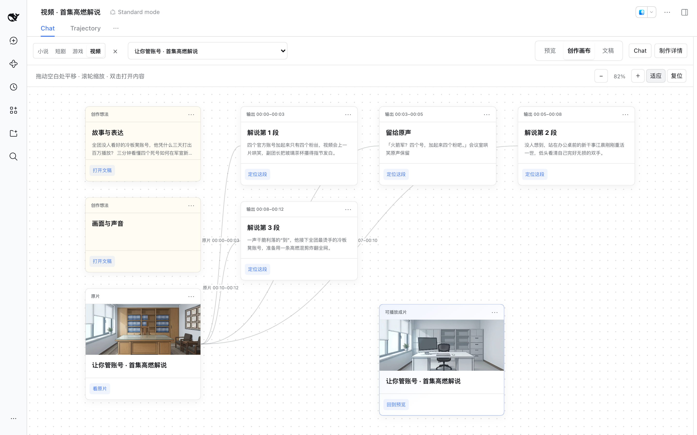

<p align="center">
  
</p>

<h1 align="center">Oh Story DSH</h1>

<p align="center">
  <b>为 DeepSeek Harness 打造的小说、短剧、互动游戏与视频解说创作工作台</b>
</p>

<p align="center">
  <a href="https://zenstory.ai/zh/dsh"><b>项目主页</b></a>
  &nbsp;·&nbsp;
  <a href="#安装"><b>快速安装</b></a>
  &nbsp;·&nbsp;
  <a href="#四个工作台"><b>四个工作台</b></a>
  &nbsp;·&nbsp;
  <a href="#看看它的输出"><b>看看它的输出</b></a>
  &nbsp;·&nbsp;
  <a href="README_EN.md"><b>English</b></a>
</p>

<p align="center">
  <a href="https://github.com/zenstory-ai/oh-story-dsh/stargazers"></a>
  <a href="https://github.com/zenstory-ai/oh-story-dsh/releases/latest"></a>
  
  <a href="./LICENSE"></a>
</p>

## 简介

`oh-story-dsh` 是 [DeepSeek Harness](https://github.com/deepseek-ai/deepseek-harness)（DSH）的开源社区插件。安装后，DSH Web 会增加**小说、短剧、互动游戏、视频解说**四个创作工作台；Agent 运行时、会话管理、模型配置与权限审批全部沿用原生 DSH，所有作品直接以普通文件保存在你的本地目录里。

| 工作台 | 内置技能包（随插件固定版本打包） | 常用入口 |
| --- | --- | --- |
| **小说** | [Oh Story 0.10.5](https://github.com/zenstory-ai/oh-story-claudecode/releases/tag/v0.10.5) · 14 Skills · 7 Roles | `/story`、`/story-long-write`、`/story-review`、`/story-publish` |
| **短剧** | [Drama Skills 0.12.1](https://github.com/zenstory-ai/drama-skills/releases/tag/v0.12.1) · 12 Skills | `/short-drama`、`/short-drama-write`、`/short-drama-storyboard`、`/short-drama-edit` |
| **互动游戏** | [NovelToGame 0.9.0](https://github.com/zenstory-ai/novel-to-game/releases/tag/v0.9.0) · 5 Skills | `/novel-to-game quick`、`/game-build`、`/game-qa` |
| **视频解说** | [video-recap-skills 0.7.1](https://github.com/zenstory-ai/video-recap-skills/releases/tag/v0.7.1) · 2 Skills | `/video-recap`、`/video-reference` |

> 当前版本 **v0.1.26**，默认配套 DeepSeek Harness `0.2.2-rc.1`（需 Node.js 24.9+），同时兼容 `0.2.1-rc.5`、`0.2.0-rc.2` 与 `0.2.2-rc.3`。完整变更见 [CHANGELOG.md](CHANGELOG.md) 与 [Releases](https://github.com/zenstory-ai/oh-story-dsh/releases)，旧项目升级注意事项见[升级说明](#升级到新版本后要做什么)。

## 安装

默认命令配套 DSH `0.2.2-rc.1`，需要 **Node.js 24.9+**（安装命令已内置临时 `pnpm`，无需提前全局安装）：

```bash
npx -y --package pnpm@11.7.0 --package @deepseek-ai/dsh@0.2.2-rc.1 dsh plugin --profile web add @oh-story/dsh@0.1.26 &&
npx -y @deepseek-ai/dsh@0.2.2-rc.1 web
```

执行后保持终端开启，浏览器若未自动弹出，复制终端打印的完整 `http://127.0.0.1:3080/?token=...` 链接访问即可（首次登录依赖链接中的 `token`）。进入界面后，在「设置 → 模型」中填入 Provider 与 API Key，或在启动前设置环境变量 `DEEPSEEK_API_KEY`；只浏览本地已有工程可在首次引导中点「稍后配置 / Configure later」。

安装和启动请保持同一个 DSH 版本（插件支持 `>=0.2.0-rc.2 <0.2.1-0`、`>=0.2.1-alpha.1 <0.2.2-0` 与 `>=0.2.2-alpha.2 <0.2.3-0`；若改用 `0.2.1-rc.5`、`0.2.0-rc.2` 或 `next` 线的 `0.2.2-rc.3`，把上面两条命令中的版本号同步替换即可）。

<details>
<summary>从 GitHub Release 安装预构建包</summary>

```bash
npx -y --package pnpm@11.7.0 --package @deepseek-ai/dsh@0.2.2-rc.1 dsh plugin --profile web add https://github.com/zenstory-ai/oh-story-dsh/releases/download/v0.1.26/oh-story-dsh-0.1.26.tgz &&
npx -y @deepseek-ai/dsh@0.2.2-rc.1 web
```

</details>

<details>
<summary>配置短剧媒体生成 API（生图 / 生视频 / 配音 / 配乐）</summary>

DeepSeek 负责撰写剧本、分镜与提示词；实际生成图片、视频、配音与配乐时，`short-drama-produce` 会调用对应供应商接口（需宿主机装有 Python 3.9+；合成成片另需 `ffmpeg`/`ffprobe`）。按需在启动 DSH 前配置环境变量即可，不配视频 Key 也能正常写分镜和出关键帧图片：

| 能力 | 供应商 | 必需环境变量 | 可选配置 |
| --- | --- | --- | --- |
| 图片 | GPT Image 2 | `OPENAI_API_KEY` | `OPENAI_BASE_URL` |
| 视频 | Seedance（火山方舟） | `ARK_API_KEY`、`SEEDANCE_MODEL` | `SEEDANCE_BASE_URL`、`SEEDANCE_POLL_INTERVAL`、`SEEDANCE_TIMEOUT_SECONDS`、`SEEDANCE_ALLOWED_RATIOS`、`SEEDANCE_MIN_DURATION` / `SEEDANCE_MAX_DURATION` |
| 视频 | MiniMax H3 | `MINIMAX_API_KEY`、`MINIMAX_VIDEO_MODEL` | `MINIMAX_VIDEO_BASE_URL`、`MINIMAX_VIDEO_POLL_INTERVAL`、`MINIMAX_VIDEO_TIMEOUT_SECONDS`、`MINIMAX_VIDEO_ALLOWED_RESOLUTIONS`、`MINIMAX_VIDEO_ALLOWED_RATIOS`、`MINIMAX_VIDEO_MIN_DURATION` / `MINIMAX_VIDEO_MAX_DURATION` |
| 语音 | MiniMax Speech | `MINIMAX_API_KEY` | `MINIMAX_BASE_URL` |
| 音乐 | MiniMax Music | `MINIMAX_API_KEY` | `MINIMAX_BASE_URL` |

```bash
export OPENAI_API_KEY=...
export ARK_API_KEY=... SEEDANCE_MODEL=...
npx -y @deepseek-ai/dsh@0.2.2-rc.1 web
```

短剧「制作详情」会直接显示各供应商是否就绪、缺少哪个环境变量（插件只检查变量是否存在，不读取或回传密钥内容）。内置的 `seedance` 与 `minimax-h3` 配置默认支持角色参考音频（`reference_audio`，仍请确认所选模型本身支持音频参考）；若需自定义 adapter、修改超时或为外部接口声明 `reference_roles`，将 `OH_STORY_DRAMA_ADAPTER_CONFIG` 指向自定义配置文件即可。各接口参数范围详见随包的 `short-drama-produce/references/builtin-providers.md`。

</details>

<details>
<summary>配置视频解说宿主机依赖（Python / ffmpeg）</summary>

视频解说流水线需要宿主机安装 **Python 3.10+** 与 `PATH` 可见的 **ffmpeg / ffprobe**（如 Ubuntu 下 `sudo apt install ffmpeg`），并在启动 DSH 的终端设置 `MIMO_API_KEY`（使用 Fish Audio 配音时另配 `FISH_API_KEY`）。`ffmpeg` 具备 `libass` 字幕滤镜时会自动烧录硬字幕，否则交付外挂 SRT 字幕文件。

</details>

<details>
<summary>装进独立 profile，与日常编程环境分开</summary>

插件安装到哪个 profile，该 profile 下启用了技能工具的会话模式（如 `Standard`、`PTC`；`Minimal` 等精简模式不加载技能工具）就能调用随包创作技能。若希望默认 `web` 环境保持纯净，可将插件装入独立的 `story` profile：

```bash
npx -y --package pnpm@11.7.0 --package @deepseek-ai/dsh@0.2.2-rc.1 dsh plugin --profile story add @oh-story/dsh@0.1.26
```

随后编辑 `~/.dsh/profiles/story/package.json`，在 `dsh.profile.bundles` 中把 Web 界面包放在插件前面：

```json
"bundles": [
  "@deepseek-ai/dsh-base",
  "@deepseek-ai/dsh-web-app",
  "@oh-story/dsh"
]
```

之后两个环境可用不同端口并行启动，模型配置、工作区与历史会话由 DSH 统一共享：

```bash
npx -y @deepseek-ai/dsh@0.2.2-rc.1 web                          # 原版 DSH
npx -y @deepseek-ai/dsh@0.2.2-rc.1 --profile story --port 3081  # 创作工作台
```

</details>

## 四个工作台

四个工作台均运行在官方 DSH Web 会话中，右侧对话、模型切换、Token 统计与权限审批全部是原生 DSH 能力。

只做某一种创作时，可在页卡旁的「工作台设置」里隐藏其他页卡，选择按当前浏览器的工作区记住；随时可「显示全部」。隐藏不删除项目，也不禁用创作技能，至少保留一个页卡。

### 小说工作台



左侧文件树、中间 Markdown 编辑器与右侧原生 Chat 同屏协作。Agent 写入设定、大纲或章节时编辑器实时跟进，点击对话里的文件路径即可打开对应文稿；作者正在编辑的未保存草稿受独立保护，不会被并发写入覆盖。覆盖选题、扫榜、拆文、长短篇连载、审稿、去 AI 味、番茄建书资料整理与封面提示词。

### 短剧工作台



每集按需维护最多五份创作文档：`剧本.md`、`视觉设定.md`、`分镜.md`、`图片提示词.md`、`视频提示词.md`。默认在无限画布中串联剧本场次、角色与场景参考板、分镜关键帧及视频片段，可自由缩放、切换采用版本，或把选中镜头带入右侧 Chat 继续打磨。「制作详情」会自动标出重复 ID 与跨文档断链的具体行号；所有生图、生视频、配音与配乐任务都会先在对话中预览并经你确认后才调用付费 API，成片由 `/short-drama-edit` 按《剪辑单.md》渲染至 `剧集/<EP>/制作成果/成片/`。

### 互动游戏工作台





围绕 `game-adaptations/<project>/` 提供「试玩 / 创作画布 / 文稿」三种视角。左侧独立沙箱直接运行 `build/app/index.html` 可玩构建，画布梳理原著依据、核心构想、玩法设计、人物世界与当前试玩版之间的对应关系。切换视图或收起对话不会中断当前试玩进度；Agent 产出新版本后，也由你决定何时载入。

### 视频解说工作台





围绕 `video-recaps/<project>/` 提供「预览 / 创作画布 / 文稿」视图。边看成片边核对分段解说与原声留白，有剪辑区间映射时可一键跳回原片核查画面；解说词支持逐段改写保存，保留原有时间轴且不会擅自重做已有配音。原片放在 `sources/`，中间产物在 `work/`，最终成片输出到 `outputs/`。

### 统一设计原则

- **本地文件即底稿**：界面展示的一切都直接来自工作区里的 Markdown、JSON 与媒体文件，不维护封闭数据库；改哪份文件就是改哪一层创作决策。
- **付费生成先确认**：短剧的媒体生成任务一律先展示预检与参数，经你在当前对话明确确认后才执行。
- **普通会话零打扰**：只有工作区存在创作工程时才会展开工作台，随时可一键收起回到纯原生 DSH 对话，展开状态按工作区记忆。各模块的职责边界详见[架构说明](docs/ARCHITECTURE.md)。

## 开始创作

首次启动后，点击左侧 **Workspaces** 旁的 **添加工作区 / Add workspace**，选中你的作品文件夹并新建会话：

- **已有工程目录**：自动识别并展示「小说 / 短剧 / 游戏 / 视频」工作台标签（不依赖会话所选模式）。
- **全新空目录**：确保会话模式启用技能加载（如默认的 `Standard` 或 `PTC`），在原生对话界面发送 `/story`、`/short-drama`、`/novel-to-game quick` 或 `/video-recap` 启动创作，Agent 写出第一份项目文件后工作台自动展开。空白会话顶部的入门引导可一键关闭，也可随时在左侧「插件 → `@oh-story/dsh`」（或 profile 的 `cordis.patch.yml` 中 `welcomeGuide: false`）开关。

可以直接复制以下提示词开局（按需替换方括号内容）：

**开一本新书**

> 我想写一部 [都市脑洞 / 历史古代] 长篇，主角开局处境是 [一句话核心设定]。先帮我梳理核心冲突、叙事视角限制和前三章的局面变化，列出还需要我拍板的问题；这一轮先定方向，暂不写正文。

**已有稿件讨论续写**

> 先读《追踪/上下文.md》、[正文/第020章.md] 和相关角色设定，帮我规划下一章的剧情推进。给两个不同的冲突切入方案，分别说明人物动机、阻力以及这场戏打完后的局面变化；先在对话里敲定细纲方向，暂不改文件。

**短剧、游戏改编与视频解说**

```text
用 /short-drama 初始化一部复仇打脸题材短剧，竖屏 9:16，先写第 1 集剧本和视觉设定，暂不生成媒体。
用 /novel-to-game quick 把当前工作区的小说改编成可玩互动切片，首个试玩构建控制在 15 分钟流程内。
用 /video-recap 给 /path/to/video.mp4 制作一条 3 分钟中文解说成片，关键台词保留原声，烧录硬字幕。
```

## 看看它的输出

以下片段直接节选自仓库内置的真实演示工程（同步自 [oh-story-claudecode 示例](https://github.com/zenstory-ai/oh-story-claudecode/tree/abe96630d115afbd528f2329e2d8d604d5d5673c/demo/%E9%95%BF%E7%AF%87) 与 [drama-skills 公开样例](https://github.com/zenstory-ai/drama-skills/tree/37232f6d22e174c36e321d2e3a1a3ae871e7d602/examples/creator-first/EP001)）。

### 1. 小说：追踪上下文与细纲硬门禁

动笔写第 21 章前，[`追踪/上下文.md`](scripts/demo-fixtures/story/让你管账号，你高燃混剪炸全网/追踪/上下文.md) 记录了当前剧情坐标、未回收伏笔与连贯性风险：

```markdown
## 当前位置
- 当前章：第20章
- 场景：火箭军文工团，钟嘉嘉送来老兵书法礼后
……
## 活跃伏笔
- F016｜钟嘉嘉并非普通军报实习生，她的军方家庭背景仍未完全公开｜埋第7章｜回收章未定｜高
……
## 连贯性风险
- 第21章尚无细纲，不能直接写正文。
```

若 Agent 跳过细纲直接写正文，插件注册在 DSH 工具链上的前置钩子会当场拦截：

```text
Oh Story 阻止写入第 21 章：未找到对应的 大纲/细纲_第021章*.md。先按 story-long-write 单章流程补建细纲再写正文。
```

### 2. 短剧：五份文档分层锁定同一镜头

`视觉设定.md` 用连戏锁固定跨镜统一的服装细节，`分镜.md` 管画面起止与调度，`视频提示词.md` 把动作转译成视频模型可执行的英文描述：

```markdown
- 连戏锁：LOCK-JIANGCHEN-DRESS《江晨松枝绿常服》（镜头：SHOT-EP001-002、SHOT-EP001-003、SHOT-EP001-007……；图片提示词项：IMG-JIANGCHEN-SHEET）· 锁定词：pine-green lapel service jacket
```

```markdown
## SHOT-EP001-002 · 四个号，四个粉
- 来源：EP001-SC001
- 时长：4s
- 起点：周薄森面对笔记本坐得笔直，右手搭在茶杯旁；江晨双手掌心朝下撑在玻璃桌沿，眼神涣散。
- 动作：哄笑声滚过来，周薄森下颌收紧、腰背又挺直一分；江晨眨了一下眼，眼神猛地聚拢。
- 终点：画面停在周薄森绷紧的脸与屏幕冷光；江晨仍撑着桌沿，留在画右边缘。
```

```markdown
## MOTION-EP001-002 · 四个号，四个粉
> …… The seated officer's jaw tightens and his back straightens a little more.
> The young man blinks once and his eyes snap into focus. ……
```

完整样例：[`剧本.md`](scripts/demo-fixtures/drama/让你管账号/剧集/EP001/剧本.md) · [`视觉设定.md`](scripts/demo-fixtures/drama/让你管账号/剧集/EP001/视觉设定.md) · [`分镜.md`](scripts/demo-fixtures/drama/让你管账号/剧集/EP001/分镜.md) · [`图片提示词.md`](scripts/demo-fixtures/drama/让你管账号/剧集/EP001/图片提示词.md) · [`视频提示词.md`](scripts/demo-fixtures/drama/让你管账号/剧集/EP001/视频提示词.md)。

### 3. 跨文档断链自动定位到行号

当分镜引用了不存在的剧本场次、视频提示词绑错镜头编号或参考图 ID 重复时，短剧「制作详情」会直接报出原因与文件行号：

```text
SHOT-EP001-002 的来源 EP001-SC009 在剧本中不存在。            分镜.md:36
MOTION-EP001-003 指向不存在的 SHOT-EP001-030。                 视频提示词.md:31
IMG-JIANGCHEN-SHEET 在当前集内重复，后出现的条目会遮蔽前一条。   图片提示词.md:3
```

## 常见问题

### 我已经在用 Claude Code 或 Codex，还需要装这个插件吗？

不需要。四套创作流水线本身都是独立的开源 Skill 仓库，可直接装进你常用的编程 Agent：[oh-story-claudecode](https://github.com/zenstory-ai/oh-story-claudecode)、[drama-skills](https://github.com/zenstory-ai/drama-skills)、[novel-to-game](https://github.com/zenstory-ai/novel-to-game)、[video-recap-skills](https://github.com/zenstory-ai/video-recap-skills)。本插件将这四套技能打包适配到 DeepSeek Harness，并补上 DSH Web 专属的四个图形工作台。如果你更偏好免本地配置的在线网页版小说工作台，可以直接使用 [ZenStory](https://app.zenstory.ai)（详见[写作环境对比](https://zenstory.ai/zh/compare/writing-workflows)）。

> 若同一台机器曾在 `~/.agents/skills` 下为其他工具装过同名 Skill，DSH 会优先加载 `~/.agents/skills` 中的副本。希望强制使用插件内置版本时，启动前指定 `DSH_AGENTS_HOME=~/.dsh-agents` 即可。

### 装上插件后，平时用 DSH 写代码会被影响吗？

不会。插件只在当前工作区确实包含创作文件时才会展示工作台，普通代码仓库里完全隐形；也可随时点击工作台顶栏的「收起创作工作台」切回标准对话，或按[安装](#安装)中的折叠说明装入独立的 `story` profile。

### DeepSeek 会直接生成图片和视频吗？Token 怎么计费？

插件自身不发起隐藏的模型请求，对话与子角色（Role）消耗的 Token 均由 DSH 原生统计并显示在每条回复下方。DeepSeek 负责文本创作与提示词生成；短剧的图片、视频、配音与配乐由 `short-drama-produce` 调用你配置的第三方媒体 API 完成，没有配置视频 API 同样可以写完五份文档并生成静态关键帧。

### 安装报错、要求认证，或进入后看不到四个工作台标签？

- **提示 `pnpm not found on PATH`**：DSH 的 `plugin add` 依赖 `pnpm`，请使用[安装](#安装)中带 `--package pnpm@11.7.0` 的完整命令。
- **要求认证或端口占用**：必须通过终端输出的完整 `?token=...` 链接完成首次认证；若 3080 端口被占用，改用 `web --port 3081` 并打开新打印的链接。
- **看不到工作台标签或页面空白**：确认 `plugin add` 与 `web` 使用了完全一致的 DSH 版本和同一个 profile；空文件夹需先在 Chat 中运行 `/story` 等命令生成首个创作文件后工作台才会出现；自定义 `story` profile 若缺少网页界面，请检查 `bundles` 中是否加入了 `@deepseek-ai/dsh-web-app`。

### 支持 Windows、macOS 和 Linux 吗？

支持。每次提交均在 macOS、Windows 与 Linux CI 上完成类型、资产与构建验证。各流水线涉及本地脚本时需准备对应宿主机工具：小说拆文/导入/追踪需 Python 3 与 Node.js 18+；短剧检查与媒体生产需 Python 3.9+，合成成片需 `ffmpeg`/`ffprobe`（烧录画面文字另需 Node.js 运行 Remotion）；视频解说需 Python 3.10+ 与 `ffmpeg`/`ffprobe`。

### 升级到新版本后要做什么？

重新运行[安装](#安装)中的 `plugin add` 命令（把 `@oh-story/dsh@` 后的版本号改为最新版本）并重启 DSH 即可。Skills 与 Roles 随插件自动更新，无需在作品目录里重复初始化。完整逐版记录见 [CHANGELOG.md](CHANGELOG.md)；若打开较早版本创建的工程，按需留意以下事项：

- **短剧项目（Drama Skills 0.12.0）**：纯浏览旧项目无需改动（工作台仍兼容《分镜.md》旧标题 `### 冻结关键帧提示词`）；若要续写下游文档或运行 `creator_markdown_check.py`，请先将旧版五份 Markdown 中的字段名改为现行直白名称（`连戏锁`/`锁定词`、`外观特征`、`提示词名称`、`首帧提示词`、`动作`、`出场设定`、`开场画面`/`动作过程`）。更早的 v0.5 结构化 JSON 项目不支持原地升级，迁移时请新建项目目录。画面文字若在 Drama 0.8 前装过 Remotion，需到 `~/.cache/short-drama-edit/remotion` 重新执行一次 `npm install`。
- **视频解说项目（video-recap 0.7+）**：旧版六个技能已合并为单一 `/video-recap` 并移除了 `dub` 与 MiMo 解说评审；续跑旧 `work/` 目录时请去掉 `--edit-mode dub`、`--review-narration` 等已移除参数，也不要再设置 `EDIT_MODE` 或 `TARGET_DURATION` 环境变量。
- **早期小说工程**：Oh Story 0.8 之前留在工作区层级的「本书：」作者记忆，可执行一次 `author_memory_commit.py migrate --workspace {工作区} --book-root {书目录}`（或直接让 Agent「整理作者记忆」）；0.9 之前导入的长篇续写前，先让 `/story-long-write` 把旧剧情单元转为单元卡。

## 延伸阅读

- [DeepSeek 写小说指南](https://zenstory.ai/zh/dsh/deepseek-novel-writing) · [导入旧稿与续写边界](https://zenstory.ai/zh/oh-story/import-and-continue)
- [短剧跨镜角色一致性](https://zenstory.ai/zh/drama-skills/character-consistency) · [有后果的互动游戏选择](https://zenstory.ai/zh/novel-to-game/meaningful-choices) · [视频解说原声与旁白分工](https://zenstory.ai/zh/video-recap/original-audio-and-narration)
- [写作环境对比](https://zenstory.ai/zh/compare/writing-workflows) · [架构说明](docs/ARCHITECTURE.md) · [验证说明](docs/VALIDATION.md)

## ZenStory AI 开源项目

Oh Story DSH 由 [ZenStory AI](https://zenstory.ai/zh)（GitHub：[@zenstory-ai](https://github.com/zenstory-ai)）维护，同系列工具包括：

| 项目 | 说明 |
| --- | --- |
| [oh-story-claudecode](https://github.com/zenstory-ai/oh-story-claudecode) | 网文创作 Skill 包：扫榜、拆文、长短篇写作、审稿、去 AI 味与封面生成 |
| [drama-skills](https://github.com/zenstory-ai/drama-skills) | AI 短剧与漫剧制作 Skill 合集：剧本、视觉设定、分镜、提示词与成片剪辑 |
| [novel-to-game](https://github.com/zenstory-ai/novel-to-game) | 小说改编互动游戏 Skill 合集：原著拆解、玩法设计、构建与盲玩验收 |
| [video-recap-skills](https://github.com/zenstory-ai/video-recap-skills) | 视频中文解说制作工具链，支持硬字幕成片与剪映 / CapCut 草稿导出 |
| [oh-story-dsh](https://github.com/zenstory-ai/oh-story-dsh) | DeepSeek Harness 社区插件，集成上述四套能力与图形创作工作台（本仓库） |
| [zenstory](https://github.com/zenstory-ai/zenstory) | 在线对话式 AI 小说创作工作台（[app.zenstory.ai](https://app.zenstory.ai)） |

## 贡献与致谢

欢迎通过 [GitHub Issues](https://github.com/zenstory-ai/oh-story-dsh/issues/new/choose) 反馈问题或建议（请附上插件版本、DSH 版本与复现步骤）。参与开发前请先阅读 [CONTRIBUTING.md](CONTRIBUTING.md)。

感谢 [DeepSeek Harness](https://github.com/deepseek-ai/deepseek-harness) 提供插件运行时、会话管理与 Web 工作台基础，感谢 [LINUX DO](https://linux.do/) 社区的交流与支持。

---

<sub>本项目为独立开源社区插件，与 DeepSeek 官方无隶属、合作或背书关系；DeepSeek Harness 名称与相关品牌标识归其权利人所有。 · <a href="CHANGELOG.md">更新日志</a> · <a href="CONTRIBUTING.md">贡献指南</a> · <a href="docs/ARCHITECTURE.md">架构说明</a> · <a href="SECURITY.md">安全策略</a> · <a href="LICENSE">MIT License</a></sub>
