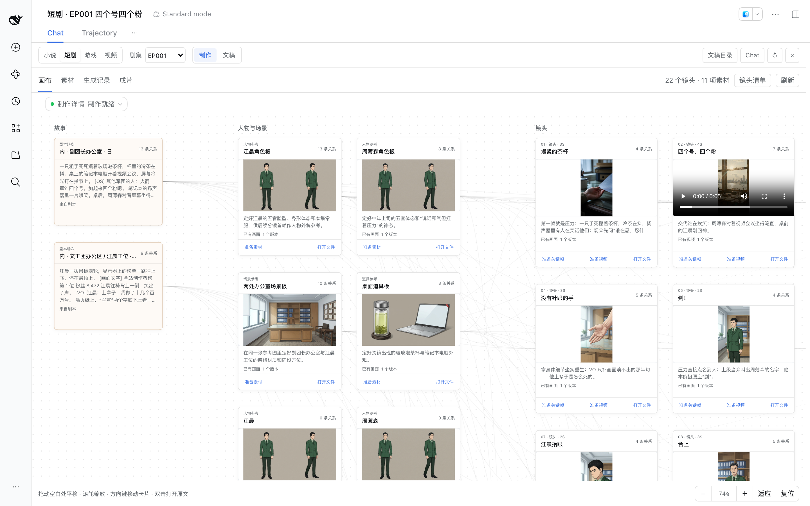
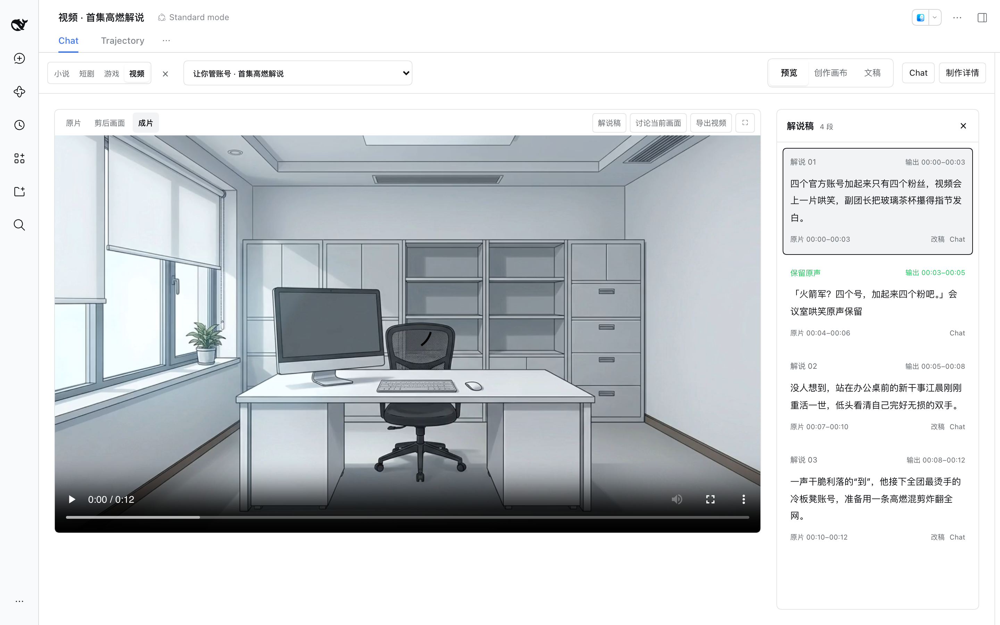

<!-- Last synced with README.md: 2026-11-15 -->

<p align="center">
  
</p>

<h1 align="center">Oh Story DSH</h1>

<p align="center">
  <b>Novel, short-drama, interactive-game, and video-recap creation workbenches for DeepSeek Harness</b>
</p>

<p align="center">
  <a href="https://zenstory.ai/dsh"><b>Project page</b></a>
  &nbsp;·&nbsp;
  <a href="#installation"><b>Install</b></a>
  &nbsp;·&nbsp;
  <a href="#the-four-workbenches"><b>Workbenches</b></a>
  &nbsp;·&nbsp;
  <a href="#see-what-it-produces"><b>See what it produces</b></a>
  &nbsp;·&nbsp;
  <a href="README.md"><b>中文</b></a>
</p>

<p align="center">
  <a href="https://github.com/zenstory-ai/oh-story-dsh/stargazers"></a>
  <a href="https://github.com/zenstory-ai/oh-story-dsh/releases/latest"></a>
  
  <a href="./LICENSE"></a>
</p>

## Overview

`oh-story-dsh` is an open-source community plugin for [DeepSeek Harness](https://github.com/deepseek-ai/deepseek-harness) (DSH). Once installed, DSH Web gains four creation workbenches — **Novel, Short Drama, Interactive Game, and Video Recap** — while agents, sessions, model settings, and permission approvals remain native DSH, and every project lives as plain files in your local workspace.

| Workbench | Bundled skill suite (pinned per release) | Main entry points |
| --- | --- | --- |
| **Novel** | [Oh Story 0.10.5](https://github.com/zenstory-ai/oh-story-claudecode/releases/tag/v0.10.5) · 14 Skills · 7 Roles | `/story`, `/story-long-write`, `/story-review`, `/story-publish` |
| **Short drama** | [Drama Skills 0.12.1](https://github.com/zenstory-ai/drama-skills/releases/tag/v0.12.1) · 12 Skills | `/short-drama`, `/short-drama-write`, `/short-drama-storyboard`, `/short-drama-edit` |
| **Interactive game** | [NovelToGame 0.9.0](https://github.com/zenstory-ai/novel-to-game/releases/tag/v0.9.0) · 5 Skills | `/novel-to-game quick`, `/game-build`, `/game-qa` |
| **Video recap** | [video-recap-skills 0.7.1](https://github.com/zenstory-ai/video-recap-skills/releases/tag/v0.7.1) · 2 Skills | `/video-recap`, `/video-reference` |

> Latest release: **v0.1.27**, paired by default with DeepSeek Harness `0.2.2-rc.1` (requires Node.js 24.9+) and also compatible with `0.2.1-rc.5`, `0.2.0-rc.2`, and `0.2.2-rc.3`. See [CHANGELOG.md](CHANGELOG.md) and [Releases](https://github.com/zenstory-ai/oh-story-dsh/releases) for full release notes, or jump to [What do I do after upgrading?](#what-do-i-do-after-upgrading) for project migration notes.

## Installation

Requires **Node.js 24.9+** (the install command supplies `pnpm` ephemerally, so nothing else needs to be preinstalled):

```bash
npx -y --package pnpm@11.7.0 --package @deepseek-ai/dsh@0.2.2-rc.1 dsh plugin --profile web add @oh-story/dsh@0.1.27 &&
npx -y @deepseek-ai/dsh@0.2.2-rc.1 web
```

Keep the terminal running. If your browser does not open automatically, open the full `http://127.0.0.1:3080/?token=...` URL printed in the terminal (first-time authentication uses the `token` parameter). Add a model provider and API key under **Settings → Models** or set `DEEPSEEK_API_KEY` before launching; to browse existing local projects without an API key, pick **Configure later** in the first-run guide.

Always use the **same DSH version** for both `plugin add` and `web` (`>=0.2.0-rc.2 <0.2.1-0`, `>=0.2.1-alpha.1 <0.2.2-0`, and `>=0.2.2-alpha.2 <0.2.3-0` are supported — replace the version in both commands together if you run `0.2.1-rc.5`, `0.2.0-rc.2`, or `0.2.2-rc.3`).

<details>
<summary>Install the prebuilt tarball from GitHub Releases</summary>

```bash
npx -y --package pnpm@11.7.0 --package @deepseek-ai/dsh@0.2.2-rc.1 dsh plugin --profile web add https://github.com/zenstory-ai/oh-story-dsh/releases/download/v0.1.27/oh-story-dsh-0.1.27.tgz &&
npx -y @deepseek-ai/dsh@0.2.2-rc.1 web
```

</details>

<details>
<summary>Configure short-drama media APIs (images / video / speech / music)</summary>

DeepSeek drafts the screenplay, storyboard, and prompts; `short-drama-produce` calls external vendor APIs to generate images, video, speech, and music (requires Python 3.9+ on the host, plus `ffmpeg`/`ffprobe` for final-cut assembly). Export only the keys you use before starting DSH — without a video key you can still write all five documents and generate keyframe images:

| Modality | Vendor | Required variables | Optional variables |
| --- | --- | --- | --- |
| Images | GPT Image 2 | `OPENAI_API_KEY` | `OPENAI_BASE_URL` |
| Video | Seedance (Volcengine Ark) | `ARK_API_KEY`, `SEEDANCE_MODEL` | `SEEDANCE_BASE_URL`, `SEEDANCE_POLL_INTERVAL`, `SEEDANCE_TIMEOUT_SECONDS`, `SEEDANCE_ALLOWED_RATIOS`, `SEEDANCE_MIN_DURATION` / `SEEDANCE_MAX_DURATION` |
| Video | MiniMax H3 | `MINIMAX_API_KEY`, `MINIMAX_VIDEO_MODEL` | `MINIMAX_VIDEO_BASE_URL`, `MINIMAX_VIDEO_POLL_INTERVAL`, `MINIMAX_VIDEO_TIMEOUT_SECONDS`, `MINIMAX_VIDEO_ALLOWED_RESOLUTIONS`, `MINIMAX_VIDEO_ALLOWED_RATIOS`, `MINIMAX_VIDEO_MIN_DURATION` / `MINIMAX_VIDEO_MAX_DURATION` |
| Speech | MiniMax Speech | `MINIMAX_API_KEY` | `MINIMAX_BASE_URL` |
| Music | MiniMax Music | `MINIMAX_API_KEY` | `MINIMAX_BASE_URL` |

```bash
export OPENAI_API_KEY=...
export ARK_API_KEY=... SEEDANCE_MODEL=...
npx -y @deepseek-ai/dsh@0.2.2-rc.1 web
```

**Production details** reports which vendors are ready and which variable is missing (checking presence only, never reading or exposing secret values). The built-in `seedance` and `minimax-h3` profiles accept character voice references (`reference_audio`) by default — verify that the specific model configured in your environment supports audio input. For custom adapters, custom timeouts, or external `reference_roles` declarations, point `OH_STORY_DRAMA_ADAPTER_CONFIG` at your own config file. Vendor constraints are documented in the bundled `short-drama-produce/references/builtin-providers.md`.

</details>

<details>
<summary>Host dependencies for the video-recap workbench (Python / ffmpeg)</summary>

The video pipeline requires **Python 3.10+** and **ffmpeg / ffprobe** on `PATH` (for example `sudo apt install ffmpeg` on Debian/Ubuntu), plus `MIMO_API_KEY` in the terminal starting DSH (and `FISH_API_KEY` when using Fish Audio TTS). Builds of `ffmpeg` with the `libass` `subtitles` filter burn subtitles into the picture; builds without `libass` deliver an external SRT file.

</details>

<details>
<summary>Install into a separate profile alongside stock DSH</summary>

Sessions in the target profile whose selected preset enables the skill tool (such as `Standard` or `PTC`; `Minimal` omits skill loading) discover the bundled creation Skills. To keep your default `web` profile untouched, install into a dedicated `story` profile:

```bash
npx -y --package pnpm@11.7.0 --package @deepseek-ai/dsh@0.2.2-rc.1 dsh plugin --profile story add @oh-story/dsh@0.1.27
```

Edit `~/.dsh/profiles/story/package.json` so DSH's Web UI bundle loads before the plugin:

```json
"bundles": [
  "@deepseek-ai/dsh-base",
  "@deepseek-ai/dsh-web-app",
  "@oh-story/dsh"
]
```

You can then run both profiles side by side on separate ports while sharing models, workspaces, and session history:

```bash
npx -y @deepseek-ai/dsh@0.2.2-rc.1 web                          # stock DSH
npx -y @deepseek-ai/dsh@0.2.2-rc.1 --profile story --port 3081  # creation workbenches
```

</details>

## The four workbenches

Every workbench runs inside official DSH Web — the chat stream, model picker, token counter, and tool approvals on the right are all native DSH.

Use **Workbench settings** beside the tabs to hide workbenches you do not use, or restore them with **Show all**. The current browser remembers the choice per workspace. At least one tab stays visible; hiding tabs does not delete projects or disable Skills.

### Novel workbench


Three coordinated panes: file tree, Markdown editor, and native Chat. The editor follows the agent live as it writes outlines, character sheets, or chapters, and clicking any file path in Chat opens it immediately. Unsaved manual edits are isolated from concurrent agent writes. Covers topic planning, chart analysis, story deconstruction, serialized long-form and short-form drafting, editorial review, de-AI-flavor polishing, platform listing copy, and cover prompts.

### Short-drama workbench



Each episode maintains up to five creator-facing Markdown files as needed: `剧本.md` (screenplay), `视觉设定.md` (visual bible), `分镜.md` (storyboard), `图片提示词.md` (image prompts), and `视频提示词.md` (video prompts). Episodes open onto an infinite canvas connecting story scenes, character and location reference plates, shot keyframes, and video takes — zoom, pick active versions, or send any card into native Chat to iterate. **Production details** pinpoints duplicate IDs or broken cross-file links with exact line numbers. Paid image, video, speech, and music jobs always pause for explicit confirmation in Chat, and `/short-drama-edit` renders the final cut from `剪辑单.md` into `剧集/<EP>/制作成果/成片/`.

### Interactive-game workbench


Built around `game-adaptations/<project>/` with **Playtest / Creative canvas / Documents** views. Play `build/app/index.html` directly inside an isolated origin and iframe sandbox on the left while mapping source material, core loop, character relationships, world design, and playable builds on the canvas. Switching views or collapsing Chat preserves your live session state, and newly built versions wait for you to load them explicitly.

### Video-recap workbench




Built around `video-recaps/<project>/` with **Preview / Creative canvas / Documents** views. Watch the cut alongside segmented narration and preserved original-sound beats, jump straight back to matching source intervals, and edit narration copy paragraph by paragraph while keeping timing intact and without silently regenerating existing voiceover. Source videos live in `sources/`, pipeline artifacts in `work/`, and finished cuts in `outputs/`.

### Shared design principles

- **Local files are the source of truth**: every surface projects plain Markdown, JSON, and media files from your workspace — no hidden project database, and editing a file directly updates that layer of the work.
- **Explicit confirmation before paid generation**: short-drama media runs preview exact parameters and preflight checks in Chat before calling any vendor API.
- **Zero clutter in coding sessions**: the workbench activates only in workspaces that contain creative projects, collapses back to standard DSH at one click, and remembers your choice per workspace. See [Architecture](docs/ARCHITECTURE.md) for ownership boundaries.

## Start creating

Click **Add workspace** next to **Workspaces** in the left sidebar, pick your project folder, and start a session:

- **Folder with existing creative work**: the `小说 / 短剧 / 游戏 / 视频` tabs open automatically regardless of session preset.
- **Empty folder**: with a skill-enabled preset (`Standard` or `PTC`), start in native Chat with `/story`, `/short-drama`, `/novel-to-game quick`, or `/video-recap`; the workbench unfolds as soon as the agent writes the first project file. The blank-session welcome guide can be dismissed inline or toggled anytime under **Plugins → `@oh-story/dsh`** (`welcomeGuide: false` in `cordis.patch.yml`).

Copy and adapt any of the starter prompts below:

**Start a new novel**

> I want to start a new [都市脑洞 (urban high-concept) / 历史古代 (historical)] serial novel where the protagonist begins in [one-line premise]. Help me map out the core conflict, POV constraints, and visible shifts across the first three chapters, plus the open choices that need my call. Let's settle the direction in Chat before drafting prose.

**Plan the next chapter of an existing manuscript**

> Read `追踪/上下文.md`, `[正文/第020章.md]`, and the relevant character sheets, then help me plan the next chapter. Propose two distinct conflict angles — what the protagonist wants, what pushes back, and how the situation changes by the end of the scene. Let's agree on the chapter outline in Chat before editing files.

**Short drama, game adaptation, and video recap**

```text
用 /short-drama 初始化一部复仇打脸题材短剧，竖屏 9:16，先写第 1 集剧本和视觉设定，暂不生成媒体。
用 /novel-to-game quick 把当前工作区的小说改编成可玩互动切片，首个试玩构建控制在 15 分钟流程内。
用 /video-recap 给 /path/to/video.mp4 制作一条 3 分钟中文解说成片，关键台词保留原声，烧录硬字幕。
```

## See what it produces

Excerpts below come verbatim from the sample workspaces in this repository (synced from the [oh-story-claudecode demo](https://github.com/zenstory-ai/oh-story-claudecode/tree/abe96630d115afbd528f2329e2d8d604d5d5673c/demo/%E9%95%BF%E7%AF%87) and the [drama-skills sample](https://github.com/zenstory-ai/drama-skills/tree/37232f6d22e174c36e321d2e3a1a3ae871e7d602/examples/creator-first/EP001)).

### 1. Novel: continuity tracking and outline gate

Before chapter 21 is drafted, [`追踪/上下文.md`](scripts/demo-fixtures/story/让你管账号，你高燃混剪炸全网/追踪/上下文.md) tracks story position, live foreshadowing threads, and continuity risks:

```markdown
## 当前位置
- 当前章：第20章
- 场景：火箭军文工团，钟嘉嘉送来老兵书法礼后
……
## 活跃伏笔
- F016｜钟嘉嘉并非普通军报实习生，她的军方家庭背景仍未完全公开｜埋第7章｜回收章未定｜高
……
## 连贯性风险
- 第21章尚无细纲，不能直接写正文。
```

If an agent tries to write chapter prose before its chapter outline exists, the plugin's pre-execute hook blocks the write immediately:

```text
Oh Story 阻止写入第 21 章：未找到对应的 大纲/细纲_第021章*.md。先按 story-long-write 单章流程补建细纲再写正文。
```

### 2. Short drama: one shot coordinated across layers

`视觉设定.md` locks recurring wardrobe phrases verbatim, `分镜.md` defines shot framing and start-to-end beats, and `视频提示词.md` translates the motion into model-ready English:

```markdown
- 连戏锁：LOCK-JIANGCHEN-DRESS《江晨松枝绿常服》（镜头：SHOT-EP001-002、SHOT-EP001-003、SHOT-EP001-007……；图片提示词项：IMG-JIANGCHEN-SHEET）· 锁定词：pine-green lapel service jacket
```

```markdown
## SHOT-EP001-002 · 四个号，四个粉
- 来源：EP001-SC001
- 时长：4s
- 起点：周薄森面对笔记本坐得笔直，右手搭在茶杯旁；江晨双手掌心朝下撑在玻璃桌沿，眼神涣散。
- 动作：哄笑声滚过来，周薄森下颌收紧、腰背又挺直一分；江晨眨了一下眼，眼神猛地聚拢。
- 终点：画面停在周薄森绷紧的脸与屏幕冷光；江晨仍撑着桌沿，留在画右边缘。
```

```markdown
## MOTION-EP001-002 · 四个号，四个粉
> …… The seated officer's jaw tightens and his back straightens a little more.
> The young man blinks once and his eyes snap into focus. ……
```

Full sample files: [`剧本.md`](scripts/demo-fixtures/drama/让你管账号/剧集/EP001/剧本.md) · [`视觉设定.md`](scripts/demo-fixtures/drama/让你管账号/剧集/EP001/视觉设定.md) · [`分镜.md`](scripts/demo-fixtures/drama/让你管账号/剧集/EP001/分镜.md) · [`图片提示词.md`](scripts/demo-fixtures/drama/让你管账号/剧集/EP001/图片提示词.md) · [`视频提示词.md`](scripts/demo-fixtures/drama/让你管账号/剧集/EP001/视频提示词.md).

### 3. Line-accurate cross-document diagnostics

Broken scene references, missing shot targets, or duplicate asset IDs surface directly in **Production details** with file names and line numbers:

```text
SHOT-EP001-002 的来源 EP001-SC009 在剧本中不存在。            分镜.md:36
MOTION-EP001-003 指向不存在的 SHOT-EP001-030。                 视频提示词.md:31
IMG-JIANGCHEN-SHEET 在当前集内重复，后出现的条目会遮蔽前一条。   图片提示词.md:3
```

## FAQ

### I already use Claude Code or Codex — do I need this plugin?

No. Each pipeline is published as a standalone skill repository for general coding agents: [oh-story-claudecode](https://github.com/zenstory-ai/oh-story-claudecode), [drama-skills](https://github.com/zenstory-ai/drama-skills), [novel-to-game](https://github.com/zenstory-ai/novel-to-game), and [video-recap-skills](https://github.com/zenstory-ai/video-recap-skills). This plugin packages all four for DeepSeek Harness and adds the four graphical workbenches in DSH Web. For a hosted zero-setup browser workspace for fiction, see [ZenStory](https://app.zenstory.ai) and the [workflow comparison](https://zenstory.ai/compare/writing-workflows).

> If you also installed same-named skills under `~/.agents/skills`, DSH prefers `~/.agents/skills` over bundled plugin skills. Set `DSH_AGENTS_HOME=~/.dsh-agents` before starting DSH to use only the plugin's bundled versions.

### Will installing this affect normal coding sessions in DSH?

No. The workbench stays hidden unless the active workspace contains creative project files. You can collapse it anytime from the workbench header, or isolate the plugin inside a dedicated `story` profile as shown under [Installation](#installation).

### Does DeepSeek generate images and video itself? How is token usage billed?

The plugin makes no background model calls of its own — every turn and sub-agent Role call is metered natively by DSH below each reply. DeepSeek writes scripts, storyboards, and prompts; `short-drama-produce` calls the external media APIs you configure for images, video, speech, and music. Without video keys you can still finish all five documents and generate static keyframes.

### Troubleshooting install, authentication, or missing workbench tabs

- **`pnpm not found on PATH`**: DSH's `plugin add` requires `pnpm` internally; run the full command under [Installation](#installation) with `--package pnpm@11.7.0`.
- **Authentication prompt or port conflict**: open the full `?token=...` URL printed in the terminal; if port `3080` is busy, start with `web --port 3081` and open the newly printed URL.
- **No workbench tabs or blank view**: ensure both `plugin add` and `web` use the exact same DSH version and profile; in an empty folder, run `/story` (or another creation command) so the agent creates the first project file; in a custom `story` profile, confirm `@deepseek-ai/dsh-web-app` is listed in `bundles`.

### Does it run on Windows, macOS, and Linux?

Yes — CI runs type, asset, unit, and build checks on macOS, Windows, and Linux on every change. Local helper scripts require standard host tools when invoked: Python 3 and Node.js 18+ for long-form novel analysis/import/tracking; Python 3.9+ and `ffmpeg`/`ffprobe` for short-drama checks, media production, and assembly (plus Node.js for Remotion on-screen text); Python 3.10+ and `ffmpeg`/`ffprobe` for video recaps.

### What do I do after upgrading?

Rerun the `plugin add` command under [Installation](#installation) with the new `@oh-story/dsh@` version and restart DSH. Bundled Skills and Roles update automatically with the plugin. See [CHANGELOG.md](CHANGELOG.md) for the full release history, and check these notes when opening older projects:

- **Short-drama projects (Drama Skills 0.12.0)**: browsing older episodes requires no edits (the workbench still reads legacy `### 冻结关键帧提示词` headings in `分镜.md`). Before continuing downstream stages or running `creator_markdown_check.py`, rename pre-0.12.0 Markdown fields to the current plain-Chinese labels (`连戏锁`/`锁定词`, `外观特征`, `提示词名称`, `首帧提示词`, `动作`, `出场设定`, `开场画面`/`动作过程`). Legacy v0.5 structured JSON projects cannot be upgraded in place — start a new project root instead. If you installed Remotion prior to Drama 0.8, rerun `npm install` once inside `~/.cache/short-drama-edit/remotion`.
- **Video-recap projects (video-recap 0.7+)**: the six legacy production skills were consolidated into `/video-recap`, removing `dub` and MiMo narration review. Drop removed flags such as `--edit-mode dub` or `--review-narration` when resuming an older `work/` directory, and unset `EDIT_MODE` / `TARGET_DURATION`.
- **Earlier novel workspaces**: workspace-level `本书：` author-memory entries from before Oh Story 0.8 can be migrated once via `author_memory_commit.py migrate --workspace {workspace} --book-root {book dir}` (or ask the agent to `整理作者记忆`); for long novels imported before Oh Story 0.9, ask `/story-long-write` to convert legacy plot units into unit cards before continuing.

## Further reading

- [Writing fiction with DeepSeek](https://zenstory.ai/dsh/deepseek-novel-writing) · [Import and continue](https://zenstory.ai/oh-story/import-and-continue)
- [Short-drama character consistency](https://zenstory.ai/drama-skills/character-consistency) · [Meaningful game choices](https://zenstory.ai/novel-to-game/meaningful-choices) · [Original sound vs. narration](https://zenstory.ai/video-recap/original-audio-and-narration)
- [Writing-environment comparison](https://zenstory.ai/compare/writing-workflows) · [Architecture](docs/ARCHITECTURE.md) · [Validation](docs/VALIDATION.md)

## ZenStory AI ecosystem

Oh Story DSH is maintained by [ZenStory AI](https://zenstory.ai) ([@zenstory-ai](https://github.com/zenstory-ai)). Related open-source projects:

| Project | Description |
| --- | --- |
| [oh-story-claudecode](https://github.com/zenstory-ai/oh-story-claudecode) | Web-fiction writing skill pack: chart scanning, deconstruction, drafting, review, de-AI-flavor, covers |
| [drama-skills](https://github.com/zenstory-ai/drama-skills) | AI short-drama and motion-comic skill suite: scripts, visual bibles, storyboards, prompts, final-cut assembly |
| [novel-to-game](https://github.com/zenstory-ai/novel-to-game) | Novel-to-game adaptation suite: source analysis, gameplay design, target builds, blind playtest QA |
| [video-recap-skills](https://github.com/zenstory-ai/video-recap-skills) | Narrated Chinese video-recap pipeline with burned-in subtitles and optional JianYing / CapCut draft export |
| [oh-story-dsh](https://github.com/zenstory-ai/oh-story-dsh) | Community DeepSeek Harness plugin bundling all four suites and graphical workbenches (this repo) |
| [zenstory](https://github.com/zenstory-ai/zenstory) | Hosted chat-native AI novel-writing workbench ([app.zenstory.ai](https://app.zenstory.ai)) |

## Contributing and acknowledgements

Report bugs, output-quality cases, or feature requests via [GitHub Issues](https://github.com/zenstory-ai/oh-story-dsh/issues/new/choose) with your plugin version, DSH version, and reproduction steps. Read [CONTRIBUTING.md](CONTRIBUTING.md) before submitting changes.

Thanks to [DeepSeek Harness](https://github.com/deepseek-ai/deepseek-harness) for the native plugin runtime, agent loop, and Web workbench foundation, and to the [LINUX DO](https://linux.do/) community for feedback and support.

---

<sub>Independent open-source community plugin, unaffiliated with and not endorsed by DeepSeek. DeepSeek Harness names and brand assets belong to their respective owners. · <a href="CHANGELOG.md">Changelog</a> · <a href="CONTRIBUTING.md">Contributing</a> · <a href="docs/ARCHITECTURE.md">Architecture</a> · <a href="SECURITY.md">Security</a> · <a href="LICENSE">MIT License</a></sub>
