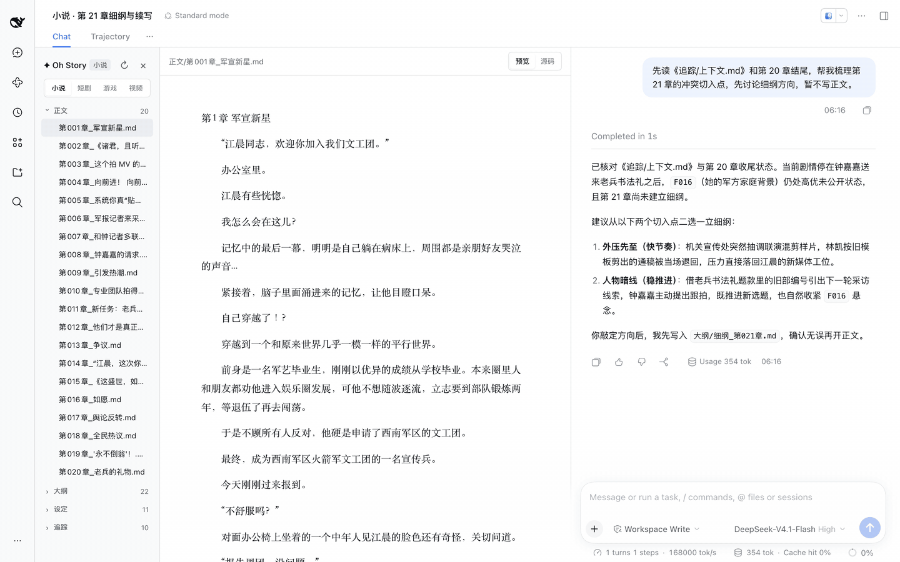
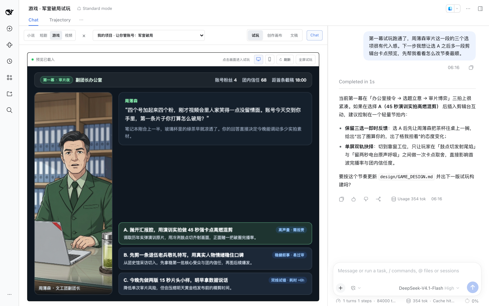
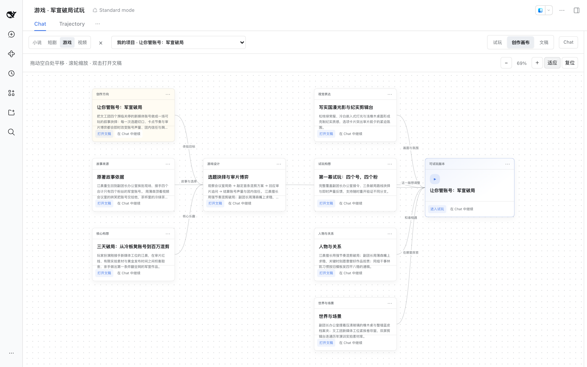
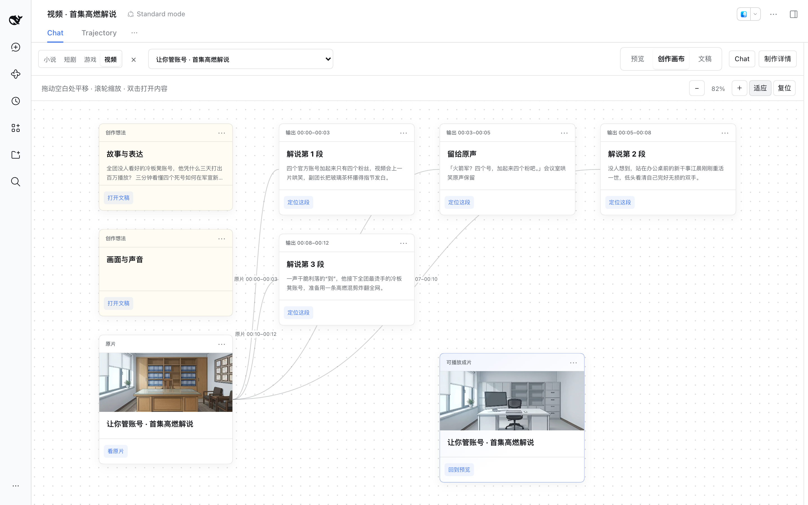

<!-- Last synced with README.md: 2026-11-22 -->

<p align="center">
  
</p>

<h1 align="center">Oh Story DSH</h1>

<p align="center">
  <b>Novel, short-drama, interactive-game, and video-recap creation workbenches for DeepSeek Harness</b>
</p>

<p align="center">
  <a href="https://zenstory.ai/dsh"><b>Project page</b></a>
  &nbsp;·&nbsp;
  <a href="#installation"><b>Install</b></a>
  &nbsp;·&nbsp;
  <a href="#the-four-workbenches"><b>Workbenches</b></a>
  &nbsp;·&nbsp;
  <a href="#see-what-it-produces"><b>See what it produces</b></a>
  &nbsp;·&nbsp;
  <a href="README.md"><b>中文</b></a>
</p>

<p align="center">
  <a href="https://github.com/zenstory-ai/oh-story-dsh/stargazers"></a>
  <a href="https://github.com/zenstory-ai/oh-story-dsh/releases/latest"></a>
  
  <a href="./LICENSE"></a>
</p>

## What it is

`oh-story-dsh` is an open-source community plugin for [DeepSeek Harness](https://github.com/deepseek-ai/deepseek-harness) (DSH) that adds four creation workbenches to DSH Web: **Novel, Short Drama, Interactive Game, and Video Recap**. Agents, sessions, model settings, and tool approvals remain native to DSH, and every project lives as plain files in your local workspace.

| Workbench | Bundled skill suite (pinned per release) | Main entry points |
| --- | --- | --- |
| **Novel** | [Oh Story 0.11.0](https://github.com/zenstory-ai/oh-story-claudecode/releases/tag/v0.11.0) · 14 Skills · 7 Roles | `/story`, `/story-long-write`, `/story-review`, `/story-publish` |
| **Short drama** | [Drama Skills 0.13.0](https://github.com/zenstory-ai/drama-skills/releases/tag/v0.13.0) · 12 Skills | `/short-drama`, `/short-drama-write`, `/short-drama-storyboard`, `/short-drama-edit` |
| **Interactive game** | [NovelToGame 0.9.0](https://github.com/zenstory-ai/novel-to-game/releases/tag/v0.9.0) · 5 Skills | `/novel-to-game quick`, `/game-build`, `/game-qa` |
| **Video recap** | [video-recap-skills 0.8.0](https://github.com/zenstory-ai/video-recap-skills/releases/tag/v0.8.0) · 2 Skills | `/video-recap`, `/video-reference` |

> Latest release: **v0.1.28**, paired by default with DeepSeek Harness `0.2.2-rc.5` (Node.js 24.9+) and also compatible with `0.2.2-rc.1`, `0.2.1-rc.5`, and `0.2.0-rc.2`. See [CHANGELOG.md](CHANGELOG.md), [Releases](https://github.com/zenstory-ai/oh-story-dsh/releases), and [Upgrading](#what-do-i-do-after-upgrading) for release and migration notes.

## Installation

Paired by default with DSH `0.2.2-rc.5` on **Node.js 24.9+** (the command brings a temporary `pnpm`, so nothing else needs to be installed globally):

```bash
npx -y --package pnpm@11.7.0 --package @deepseek-ai/dsh@0.2.2-rc.5 dsh plugin --profile web add @oh-story/dsh@0.1.28 &&
npx -y @deepseek-ai/dsh@0.2.2-rc.5 web
```

Keep the terminal open; if the browser does not launch automatically, open the full `http://127.0.0.1:3080/?token=...` URL printed in the terminal (first-time login uses the `token` query parameter). Add a provider and API key under **Settings → Models** or export `DEEPSEEK_API_KEY` before launching; to browse local projects without an API key, click **Configure later** in the first-run guide.

Use the **same DSH version** for both `plugin add` and `web` (`>=0.2.0-rc.2 <0.2.1-0`, `>=0.2.1-alpha.1 <0.2.2-0`, and `>=0.2.2-alpha.2 <0.2.3-0` are supported; update both commands together if you run `0.2.1-rc.5` or `0.2.0-rc.2`).

<details>
<summary>Install the prebuilt tarball from GitHub Releases</summary>

```bash
npx -y --package pnpm@11.7.0 --package @deepseek-ai/dsh@0.2.2-rc.5 dsh plugin --profile web add https://github.com/zenstory-ai/oh-story-dsh/releases/download/v0.1.28/oh-story-dsh-0.1.28.tgz &&
npx -y @deepseek-ai/dsh@0.2.2-rc.5 web
```

</details>

<details>
<summary>Configure short-drama media APIs (images / video / speech / music)</summary>

DeepSeek writes the screenplay, storyboard, and prompts; `short-drama-produce` calls external vendor APIs for images, video, speech, and music (requires Python 3.9+ locally, plus `ffmpeg`/`ffprobe` for final-cut assembly). Export only the keys you need before starting DSH; without a video key you can still finish all five documents and generate keyframe images:

| Modality | Vendor | Required variables | Optional variables |
| --- | --- | --- | --- |
| Images | OpenAI Image (`openai-image`) | `OPENAI_API_KEY` | `OPENAI_IMAGE_MODEL` (or job `parameters.model`), `OPENAI_BASE_URL` |
| Video | Seedance (Volcengine Ark) | `ARK_API_KEY`, `SEEDANCE_MODEL` | `SEEDANCE_BASE_URL`, `SEEDANCE_POLL_INTERVAL`, `SEEDANCE_TIMEOUT_SECONDS`, `SEEDANCE_ALLOWED_RATIOS`, `SEEDANCE_MIN_DURATION` / `SEEDANCE_MAX_DURATION` |
| Video | MiniMax H3 | `MINIMAX_API_KEY`, `MINIMAX_VIDEO_MODEL` | `MINIMAX_VIDEO_BASE_URL`, `MINIMAX_VIDEO_POLL_INTERVAL`, `MINIMAX_VIDEO_TIMEOUT_SECONDS`, `MINIMAX_VIDEO_ALLOWED_RESOLUTIONS`, `MINIMAX_VIDEO_ALLOWED_RATIOS`, `MINIMAX_VIDEO_MIN_DURATION` / `MINIMAX_VIDEO_MAX_DURATION` |
| Speech | MiniMax Speech | `MINIMAX_API_KEY` | `MINIMAX_BASE_URL` |
| Music | MiniMax Music | `MINIMAX_API_KEY` | `MINIMAX_MUSIC_MODEL` (or job `parameters.model`), `MINIMAX_BASE_URL` |

```bash
export OPENAI_API_KEY=...
export ARK_API_KEY=... SEEDANCE_MODEL=...
npx -y @deepseek-ai/dsh@0.2.2-rc.5 web
```

**Production details** shows which vendors are ready and which variables are missing (checking presence only, never reading or returning secret values). The built-in `seedance` and `minimax-h3` profiles accept character voice references (`reference_audio`) by default; confirm that your configured model supports audio input. For custom adapters, timeouts, or external `reference_roles`, point `OH_STORY_DRAMA_ADAPTER_CONFIG` at your config file. See the bundled `short-drama-produce/references/builtin-providers.md` for parameter limits.

</details>

<details>
<summary>Local dependencies for the video-recap workbench (Python / ffmpeg)</summary>

Video Recap 0.8.0 is local-first and only requires **Python 3.10+** and **ffmpeg / ffprobe** on `PATH` (for example `sudo apt install ffmpeg` on Debian/Ubuntu). For optional cloud ASR or TTS, export `ASR_API_URL` / `ASR_API_KEY`, `FISH_API_KEY` (or `FISH_AUDIO_API_KEY`), `OPENAI_API_KEY`, or self-hosted `INDEX_TTS_ENDPOINT`. When `ffmpeg` includes `libass`, subtitles are burned into the video.

</details>

<details>
<summary>Install into a separate profile alongside stock DSH</summary>

Bundled Skills load in any session preset that enables the skill tool (`Standard` or `PTC`; `Minimal` skips skills). To leave your default `web` profile untouched, install into a separate `story` profile:

```bash
npx -y --package pnpm@11.7.0 --package @deepseek-ai/dsh@0.2.2-rc.5 dsh plugin --profile story add @oh-story/dsh@0.1.28
```

Then edit `~/.dsh/profiles/story/package.json` so DSH's Web UI loads before the plugin:

```json
"bundles": [
  "@deepseek-ai/dsh-base",
  "@deepseek-ai/dsh-web-app",
  "@oh-story/dsh"
]
```

Run both profiles side by side on different ports while sharing models, workspaces, and session history:

```bash
npx -y @deepseek-ai/dsh@0.2.2-rc.5 web                          # stock DSH
npx -y @deepseek-ai/dsh@0.2.2-rc.5 --profile story --port 3081  # creation workbenches
```

</details>

## The four workbenches

All four workbenches run inside official DSH Web, keeping native DSH chat, model switching, token counts, and tool approvals on the right. Use **Workbench settings** beside the tabs to hide unused tabs per workspace and restore them anytime with **Show all**; hiding tabs never deletes files or disables Skills.

### Novel workbench



File tree, Markdown editor, and native Chat work side by side: the editor follows live as the agent writes character sheets, outlines, or chapters, clicking any file path in Chat opens it, and unsaved manual edits are protected from concurrent writes. Covers topic planning, chart scanning, book deconstruction, serialized long- and short-form drafting, review, de-AI-flavor polish, platform listing copy, and cover prompts.

### Short-drama workbench


Each episode maintains up to five Markdown files as needed: `剧本.md` (screenplay), `视觉设定.md` (visual settings), `分镜.md` (storyboard), `图片提示词.md` (image prompts), and `视频提示词.md` (video prompts). An infinite canvas links scenes, character and location plates, keyframes, and video takes so you can zoom, switch active versions, or send any shot into Chat to iterate. **Production details** flags duplicate IDs and broken cross-file references by line number; paid image, video, speech, and music runs wait for your confirmation in Chat, and `/short-drama-edit` renders the final cut from `剪辑单.md` into `剧集/<EP>/制作成果/成片/`.

### Interactive-game workbench





Built around `game-adaptations/<project>/` with **Playtest / Creative canvas / Documents** views. Play `build/app/index.html` inside an isolated iframe sandbox on the left while tracing source material, core gameplay, characters, world rules, and builds on the canvas; switching views or collapsing Chat keeps your playtest state intact, and new builds wait for you to load them.

### Video-recap workbench




Built around `video-recaps/<project>/` with **Preview / Creative canvas / Documents** views. Watch the cut alongside segmented narration and preserved original dialogue, jump back to matching source intervals, and edit narration segment by segment without shifting timing or regenerating existing voiceover. Source videos live in `sources/`, working files in `work/`, and finished cuts in `outputs/`.

### Shared principles

- **Plain files first**: every view reads Markdown, JSON, and media files straight from your workspace with no hidden database — editing a file updates the project directly.
- **Confirmation before paid calls**: short-drama media jobs show preflight checks and parameters in Chat and wait for your approval before calling external APIs.
- **Out of the way for coding**: workbenches open only in folders with creative files and collapse to stock DSH in one click; see [`docs/ARCHITECTURE.md`](docs/ARCHITECTURE.md) for boundaries.

## Start creating

Click **Add workspace** beside **Workspaces** in the left sidebar, choose your project folder, and start a session:

- **Existing creative folder**: the `小说 / 短剧 / 游戏 / 视频` tabs open automatically regardless of session preset.
- **Empty folder**: pick a skill-enabled preset (`Standard` or `PTC`) and send `/story`, `/short-drama`, `/novel-to-game quick`, or `/video-recap` in Chat; the workbench opens as soon as the first project file is written. Dismiss the welcome card inline or toggle it under **Plugins → `@oh-story/dsh`** (`welcomeGuide: false` in `cordis.patch.yml`).

Copy and adapt any starter prompt below:

**Start a new novel**

> I want to write an [urban high-concept / historical] serial novel where the protagonist starts in [one-line premise]. Map out the core conflict, POV limits, and situation shifts across the first three chapters, plus the open choices that need my call; let's lock the direction in Chat before drafting prose.

**Plan the next chapter of an existing manuscript**

> Read `追踪/上下文.md`, `[正文/第020章.md]`, and the relevant character sheets, then plan the next chapter. Propose two distinct conflict angles — what each character wants, what pushes back, and how the situation shifts by the end of the scene. Let's settle the chapter outline in Chat before editing files.

**Short drama, game adaptation, and video recap**

```text
Use /short-drama to initialize a vertical 9:16 revenge short drama; draft Episode 1's screenplay and visual settings first without generating media.
Use /novel-to-game quick to adapt the novel in this workspace into a playable interactive slice, keeping the first build around 15 minutes.
Use /video-recap to turn /path/to/video.mp4 into a 3-minute Chinese-narrated recap, preserving key original dialogue and burning in subtitles.
```

## See what it produces

Excerpts below come from the sample workspaces in this repository (synced from the [oh-story-claudecode demo](https://github.com/zenstory-ai/oh-story-claudecode/tree/abe96630d115afbd528f2329e2d8d604d5d5673c/demo/%E9%95%BF%E7%AF%87) and the [drama-skills sample](https://github.com/zenstory-ai/drama-skills/tree/37232f6d22e174c36e321d2e3a1a3ae871e7d602/examples/creator-first/EP001)).

### 1. Novel: continuity tracking and outline gate

Before chapter 21 is drafted, [`追踪/上下文.md`](scripts/demo-fixtures/story/让你管账号，你高燃混剪炸全网/追踪/上下文.md) records the current story position, active foreshadowing threads, and continuity risks (translated):

```markdown
## Current position
- Current chapter: Chapter 20
- Scene: Rocket Force arts troupe, after Zhong Jiajia delivers the veterans' calligraphy gift
…
## Active foreshadowing
- F016 | Zhong Jiajia is not an ordinary military-press intern; her family's military background is still partly undisclosed | Planted: Ch. 7 | Payoff: TBD | High
…
## Continuity risks
- Chapter 21 has no chapter outline yet; do not draft prose directly.
```

If the agent tries to draft prose before the chapter outline exists, the plugin's pre-execute hook blocks the write on the spot (translated):

```text
Oh Story blocked writing Chapter 21: no matching 大纲/细纲_第021章*.md found. Build the chapter outline via the story-long-write single-chapter flow before drafting prose.
```

### 2. Short drama: one shot locked across five files

`视觉设定.md` locks recurring wardrobe details across shots, `分镜.md` defines framing and start-to-end beats, and `视频提示词.md` turns that action into model-ready English (translated; English prompt verbatim):

```markdown
- Continuity lock: LOCK-JIANGCHEN-DRESS "Jiang Chen's pine-green service uniform" (shots: SHOT-EP001-002, SHOT-EP001-003, SHOT-EP001-007…; image prompt: IMG-JIANGCHEN-SHEET) · Locked phrase: pine-green lapel service jacket
```

```markdown
## SHOT-EP001-002 · Four accounts, four followers
- Source: EP001-SC001
- Duration: 4s
- Start: Zhou Bosen sits bolt upright facing his laptop, right hand beside the tea tumbler; Jiang Chen leans on the glass desk edge with both palms flat, eyes unfocused.
- Action: As laughter rolls out of the speaker, Zhou Bosen's jaw tightens and his back straightens another notch; Jiang Chen blinks once and his eyes snap into focus.
- End: Holds on Zhou Bosen's tight face in the cold screen glow; Jiang Chen stays leaning at the right edge of the frame.
```

```markdown
## MOTION-EP001-002 · Four accounts, four followers
> … The seated officer's jaw tightens and his back straightens a little more.
> The young man blinks once and his eyes snap into focus. …
```

Full sample files: [`剧本.md`](scripts/demo-fixtures/drama/让你管账号/剧集/EP001/剧本.md) · [`视觉设定.md`](scripts/demo-fixtures/drama/让你管账号/剧集/EP001/视觉设定.md) · [`分镜.md`](scripts/demo-fixtures/drama/让你管账号/剧集/EP001/分镜.md) · [`图片提示词.md`](scripts/demo-fixtures/drama/让你管账号/剧集/EP001/图片提示词.md) · [`视频提示词.md`](scripts/demo-fixtures/drama/让你管账号/剧集/EP001/视频提示词.md).

### 3. Cross-file broken links pinpointed by line number

When a shot cites a missing scene, a video prompt points to a nonexistent shot, or an image ID is duplicated, **Production details** reports the exact file and line number (translated):

```text
Source EP001-SC009 of SHOT-EP001-002 does not exist in the screenplay.               分镜.md:36
MOTION-EP001-003 points to missing shot SHOT-EP001-030.                              视频提示词.md:31
IMG-JIANGCHEN-SHEET is duplicated in this episode; the later entry shadows the first. 图片提示词.md:3
```

## FAQ

### I already use Claude Code or Codex — do I need this plugin?

No — all four skill suites are standalone open-source repositories ([oh-story-claudecode](https://github.com/zenstory-ai/oh-story-claudecode), [drama-skills](https://github.com/zenstory-ai/drama-skills), [novel-to-game](https://github.com/zenstory-ai/novel-to-game), [video-recap-skills](https://github.com/zenstory-ai/video-recap-skills)) for general coding agents, and [ZenStory](https://app.zenstory.ai) offers a zero-setup browser workspace for novels and short dramas. This plugin packages them for DeepSeek Harness and adds the four graphical workbenches in DSH Web. If `~/.agents/skills` already contains same-named skills, set `DSH_AGENTS_HOME=~/.dsh-agents` before launch to use the bundled versions.

### Will installing this affect normal coding sessions in DSH?

No — the workbenches stay hidden unless the workspace contains creative project files. You can collapse them anytime from the header or isolate the plugin in a separate `story` profile as shown under [Installation](#installation).

### Does DeepSeek generate images and video itself? How is token usage billed?

The plugin makes no hidden model calls; DSH natively meters every chat turn and Role call below each reply. DeepSeek writes scripts, storyboards, and prompts, while `short-drama-produce` calls the external media APIs you configure for images, video, speech, and music. Without video keys, you can still complete all five short-drama files and generate keyframe images.

### Troubleshooting install, authentication, or missing workbench tabs

If `plugin add` reports `pnpm not found on PATH`, run the full command under [Installation](#installation) with `--package pnpm@11.7.0`. For authentication prompts or port `3080` conflicts, open the full `?token=...` URL printed in the terminal or restart with `web --port 3081`. If the workbench tabs are missing, make sure `plugin add` and `web` use the same DSH version and profile (with `@deepseek-ai/dsh-web-app` in custom `bundles`), and run `/story` or another creation command in an empty folder to create the first project file.

### Does it run on Windows, macOS, and Linux?

Yes — CI runs type, asset, unit, and build checks across macOS, Windows, and Linux on every commit. Local pipeline scripts use standard local tools when invoked: Python 3 and Node.js 18+ for novel analysis and tracking, Python 3.9+ and `ffmpeg`/`ffprobe` for short-drama production and assembly (plus Node.js for Remotion text overlays), and Python 3.10+ with `ffmpeg`/`ffprobe` for video recaps.

### What do I do after upgrading?

Rerun the `plugin add` command under [Installation](#installation) with the latest `@oh-story/dsh@` version and restart DSH; bundled Skills and Roles update automatically. Migration notes for projects created with older versions are documented in [CHANGELOG.md](CHANGELOG.md).

## Acknowledgments

- <https://github.com/deepseek-ai/deepseek-harness>
- <https://linux.do>

## Part of ZenStory AI

Maintained by [ZenStory AI](https://zenstory.ai) (GitHub: [@zenstory-ai](https://github.com/zenstory-ai)). Sibling open-source projects:

| Project | What it does |
| --- | --- |
| [oh-story-claudecode](https://github.com/zenstory-ai/oh-story-claudecode) | Web-fiction skill pack: chart scanning, deconstruction, outlining, long/short drafting, continuity tracking, de-AI-flavor polish, and covers |
| [drama-skills](https://github.com/zenstory-ai/drama-skills) | AI short-drama & motion-comic skill suite: source/benchmark breakdown, scripts, visual settings, storyboards, image/video prompts, confirmed production, and final cuts |
| [novel-to-game](https://github.com/zenstory-ai/novel-to-game) | Novel-to-game skill pack: source analysis, gameplay & art design, builds, and blind-playtest QA for web games, interactive films, and WeChat/Douyin/TapTap mini-games |
| [video-recap-skills](https://github.com/zenstory-ai/video-recap-skills) | AI video-recap skill pack: auto shot-cutting, visual narration scripting, voiceover/mix with burned-in subtitles, and editable JianYing / CapCut draft export |
| [oh-story-dsh](https://github.com/zenstory-ai/oh-story-dsh) | Community DeepSeek Harness plugin bundling visual workbenches for novels, short dramas, games, and video recaps (this repo) |
| [zenstory](https://github.com/zenstory-ai/zenstory) | Chat-to-create AI web workbench for novels and short dramas ([app.zenstory.ai](https://app.zenstory.ai)) |

<sub>Independent open-source community plugin, unaffiliated with and not endorsed by DeepSeek; DeepSeek Harness names and brand assets belong to their respective owners.</sub>
