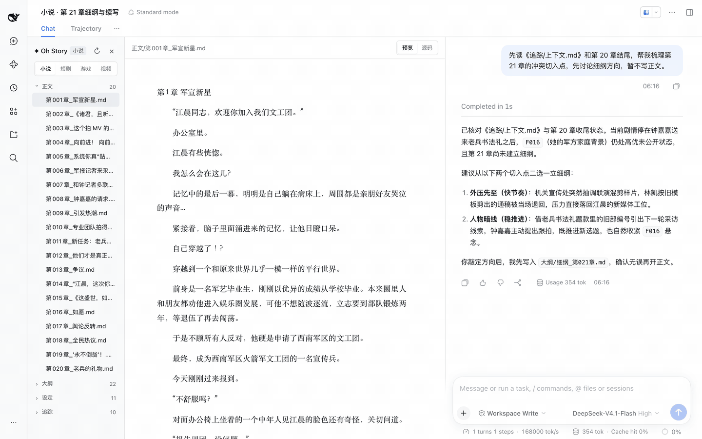
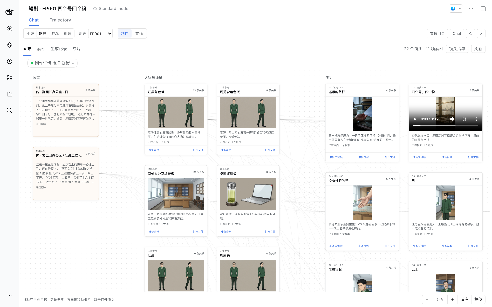
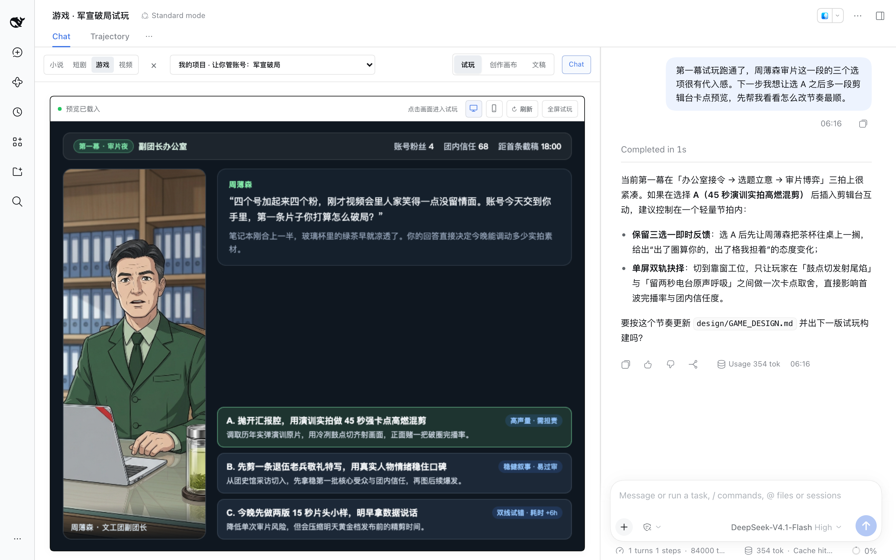
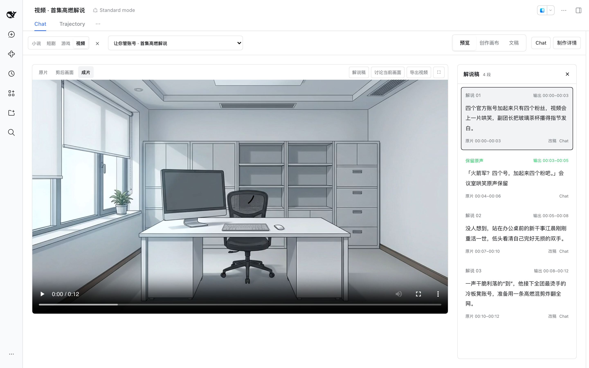

# @oh-story/dsh

[GitHub](https://github.com/zenstory-ai/oh-story-dsh) · [项目主页](https://zenstory.ai/zh/dsh) · [DeepSeek Harness](https://github.com/deepseek-ai/deepseek-harness) · [CHANGELOG](https://github.com/zenstory-ai/oh-story-dsh/blob/main/CHANGELOG.md) · [MIT](LICENSE)

为 [DeepSeek Harness](https://github.com/deepseek-ai/deepseek-harness)（DSH）打造的开源小说、短剧、互动游戏与视频解说创作工作台插件。Agent、会话、模型配置与权限审批继续走原生 DSH，作品直接以普通文件保存在本地工作区里。

| 工作台 | 内置技能包（随插件固定版本打包） | 常用入口 |
| --- | --- | --- |
| **小说** | [Oh Story 0.10.5](https://github.com/zenstory-ai/oh-story-claudecode/releases/tag/v0.10.5) · 14 Skills · 7 Roles | `/story`、`/story-long-write`、`/story-review`、`/story-publish` |
| **短剧** | [Drama Skills 0.12.1](https://github.com/zenstory-ai/drama-skills/releases/tag/v0.12.1) · 12 Skills | `/short-drama`、`/short-drama-write`、`/short-drama-storyboard`、`/short-drama-edit` |
| **互动游戏** | [NovelToGame 0.9.0](https://github.com/zenstory-ai/novel-to-game/releases/tag/v0.9.0) · 5 Skills | `/novel-to-game quick`、`/game-build`、`/game-qa` |
| **视频解说** | [video-recap-skills 0.7.1](https://github.com/zenstory-ai/video-recap-skills/releases/tag/v0.7.1) · 2 Skills | `/video-recap`、`/video-reference` |

## 安装与启动

默认配套 DSH `0.2.2-rc.1`，需要 **Node.js 24.9+**（命令已自带临时 `pnpm`，无需提前全局安装）：

```bash
npx -y --package pnpm@11.7.0 --package @deepseek-ai/dsh@0.2.2-rc.1 dsh plugin --profile web add @oh-story/dsh@0.1.27 &&
npx -y @deepseek-ai/dsh@0.2.2-rc.1 web
```

也可直接安装 GitHub Release 预构建包：

```bash
npx -y --package pnpm@11.7.0 --package @deepseek-ai/dsh@0.2.2-rc.1 dsh plugin --profile web add https://github.com/zenstory-ai/oh-story-dsh/releases/download/v0.1.27/oh-story-dsh-0.1.27.tgz &&
npx -y @deepseek-ai/dsh@0.2.2-rc.1 web
```

保持终端开启；浏览器若未自动弹出，复制终端打印的完整 `http://127.0.0.1:3080/?token=...` 链接打开（首次登录靠链接里的 `token` 认证）。进入后在「设置 → 模型」填入 Provider 与 API Key，或在启动前设置环境变量 `DEEPSEEK_API_KEY`；只看本地已有工程可在首次引导点「稍后配置 / Configure later」。

安装和启动请保持同一个 DSH 版本。默认配套 `0.2.2-rc.1`，同时兼容 `>=0.2.0-rc.2 <0.2.1-0`、`>=0.2.1-alpha.1 <0.2.2-0` 与 `>=0.2.2-alpha.2 <0.2.3-0`（含 `0.2.1-rc.5`、`0.2.0-rc.2` 与 `0.2.2-rc.3`）。

## 四个创作工作台

四个工作台都跑在官方 DSH Web 会话里，右侧对话、模型切换、Token 统计与权限审批均为原生 DSH 界面。只用其中一部分时，可在页卡旁的「工作台设置」隐藏其余页卡（按当前浏览器的工作区记忆，至少留一个，随时可「显示全部」；隐藏不会删文件或停用技能）。

### 小说工作台



文件树、Markdown 编辑器与原生 Chat 同屏联动：Agent 写设定、大纲或正文时编辑器实时跟进，点对话里的文件路径就能打开对应文稿，手动改写中的未保存草稿不会被并发写入冲掉。覆盖选题、扫榜、拆文、长短篇连载、审稿、去 AI 味、番茄建书资料与封面提示词。

### 短剧工作台



每集按需维护最多五份文档：`剧本.md`、`视觉设定.md`、`分镜.md`、`图片提示词.md`、`视频提示词.md`。无限画布把剧本场次、角色与场景参考板、分镜关键帧和视频片段串在同一视图里，可自由缩放、切换采用版本，或点选镜头送进右侧 Chat 接着改。「制作详情」会标出重复 ID 与跨文件断链的具体行号；生图、生视频、配音与配乐一律先在对话里预览参数并经你确认才调付费接口，成片由 `/short-drama-edit` 按 `剪辑单.md` 渲染到 `剧集/<EP>/制作成果/成片/`。

### 互动游戏工作台



围绕 `game-adaptations/<project>/` 提供「试玩 / 创作画布 / 文稿」三种视图。左侧独立沙箱直接运行 `build/app/index.html` 可玩版本，画布对照展示原著依据、核心玩法、人物世界与当前构建；切视图或收起对话不会打断试玩进度，新构建生成后也由你决定何时载入。

### 视频解说工作台



围绕 `video-recaps/<project>/` 提供「预览 / 创作画布 / 文稿」三种视图。边看成片边核对分段旁白与原声留白，有剪辑映射时可一键跳回原片对应区间；解说词可逐段改写保存，保留原有时间轴且不会擅自重做已有配音。

## 媒体 API 与宿主机依赖

- **短剧媒体生成（可选）**：需宿主机安装 Python 3.9+，合成成片另需 `ffmpeg`/`ffprobe`。启动 DSH 前按需导出环境变量即可：图片 `OPENAI_API_KEY`（GPT Image 2）；视频 `ARK_API_KEY` + `SEEDANCE_MODEL`（Seedance）或 `MINIMAX_API_KEY` + `MINIMAX_VIDEO_MODEL`（MiniMax H3）；语音 / 音乐 `MINIMAX_API_KEY`。内置 `seedance` 与 `minimax-h3` 默认支持角色参考音频 `reference_audio`（仍请确认所选模型本身支持音频输入）；要自定义外部 adapter 或声明 `reference_roles`，将 `OH_STORY_DRAMA_ADAPTER_CONFIG` 指向自定义配置文件即可。
- **视频解说依赖（按需）**：需宿主机安装 Python 3.10+、`PATH` 可见的 `ffmpeg`/`ffprobe`，并在启动终端设置 `MIMO_API_KEY`（用 Fish Audio 配音另配 `FISH_API_KEY`）。`ffmpeg` 带 `libass` 滤镜时默认烧录硬字幕，否则输出外挂 SRT。

## 独立 Profile 按需加载

想让默认 `web` 环境保持原样，可把插件装进独立的 `story` profile：

```bash
npx -y --package pnpm@11.7.0 --package @deepseek-ai/dsh@0.2.2-rc.1 dsh plugin --profile story add @oh-story/dsh@0.1.27
```

将 `~/.dsh/profiles/story/package.json` 中的 `dsh.profile.bundles` 设为 `["@deepseek-ai/dsh-base", "@deepseek-ai/dsh-web-app", "@oh-story/dsh"]`，之后即可用 `npx -y @deepseek-ai/dsh@0.2.2-rc.1 --profile story --port 3081` 单独启动创作工作台。

## 常见问题与升级说明

- **安装报 `pnpm not found on PATH`，或要求认证 / 端口冲突**：执行上方带 `--package pnpm@11.7.0` 的完整安装命令；提示需要认证时打开终端打印的完整 `?token=...` 链接，端口 `3080` 被占用可改用 `web --port 3081`。
- **看不到工作台标签或技能未生效**：打开已有作品目录即可自动展开工作台；从空目录新建作品时，请确认当前会话模式支持加载技能（如默认的 `Standard` 或 `PTC`，`Minimal` 模式不加载插件技能），在对话里发 `/story`、`/short-drama`、`/novel-to-game quick` 或 `/video-recap` 写出首个项目文件即可。已收起的工作台可点会话角落的「创作工作台」恢复；空白会话的入门引导可点右上角「关闭欢迎引导」，或在「插件 → `@oh-story/dsh`」随时开关。若本机 `~/.agents/skills` 装过同名 Skill，启动前设 `DSH_AGENTS_HOME=~/.dsh-agents` 即可使用插件内置版本。
- **旧版工程升级提示**：Drama Skills `0.12.0` 之前的短剧文稿只浏览无需改动，续写或运行 `creator_markdown_check.py` 前需把旧字段名改为现行直白名称；video-recap `0.7+` 续跑旧 `work/` 时需去掉 `--edit-mode dub`、`--review-narration` 等已移除参数。完整说明见仓库 [README](https://github.com/zenstory-ai/oh-story-dsh#升级到新版本后要做什么) 与 [CHANGELOG](https://github.com/zenstory-ai/oh-story-dsh/blob/main/CHANGELOG.md)。

---

本项目为独立开源社区插件，与 DeepSeek 官方无隶属、合作或背书关系；DeepSeek Harness 名称与相关品牌标识归其权利人所有。 · [MIT License](LICENSE)
